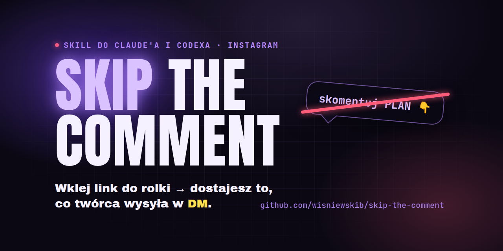
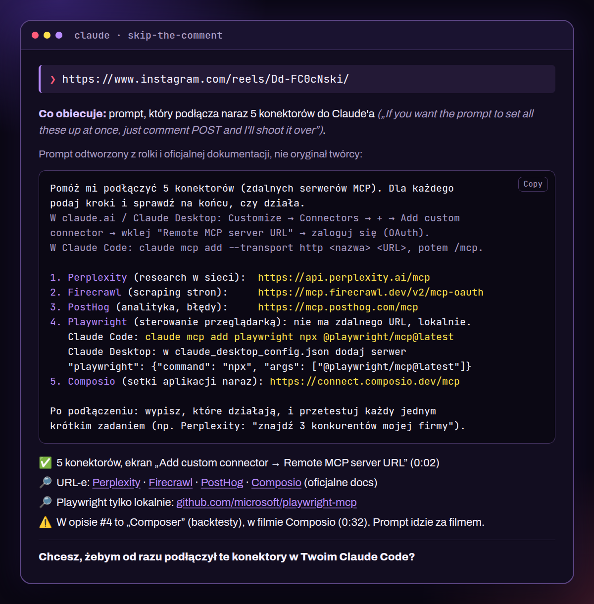

# skip-the-comment



    

**Wklej link do rolki z Instagrama → dostajesz to, co twórca wysyła w DM. Bez komentowania.**

„Skomentuj PLAN, a wyślę ci pełną instrukcję”: już nie musisz.

## Start: skopiuj jedno zdanie i wklej do Claude'a albo Codexa

To samo zdanie działa w Claude Code, na claude.ai i w Codex.

**Zainstaluj na stałe** (Claude Code, claude.ai albo Codex):

```
Zainstaluj ten skill: https://github.com/wisniewskib/skip-the-comment
```

**Bez instalacji** (podmień link do rolki):

```
Użyj https://github.com/wisniewskib/skip-the-comment na tej rolce: <link do rolki>
```

Potem wklejasz już tylko link do rolki albo posta. Za pierwszym razem agent pokaże, co musi doinstalować, i zapyta o zgodę.

## Co dostajesz



- ✅ z rolki (powiedziane, pokazane albo napisane)
- 🔎 z researchu, zawsze z linkiem do źródła
- ❓ przypuszczenie, z informacją, czego brakuje
- ⚠️ twórca mówi co innego niż źródła

Research szuka po temacie, nie po twórcy. Zdrowie i trening to badania naukowe i WHO, prawo to oficjalne teksty ustaw, finanse to regulatorzy, a tech to oficjalna dokumentacja.

## Jak to działa

1. **Pobranie** rolki albo wszystkich slajdów karuzeli, opisu i (jeśli się da) komentarzy.
2. **Transkrypcja** tego, co mówi twórca, lokalnie na Twoim komputerze.
3. **Klatki** co sekundę, sklejone w siatki: agent czyta tekst z ekranu.
4. **Komentarze:** odrzuca wszystko, co się powtarza (słowo-wyzwalacz, auto-odpowiedzi twórcy), zostawia resztę i linki.
5. **Research** tego, czego brakuje, w wiarygodnych źródłach.
6. **Krótka odpowiedź** z oznaczeniami i jedną propozycją, co dalej.

## Wymagania i po co każde

| Co | Rozmiar | Po co |
|---|---|---|
| Python 3.10+ | (masz go zwykle; na macOS: `brew install python` albo python.org) | uruchamia skrypty skilla |
| `yt-dlp` (z `curl-cffi`) | ~25 MB | pobiera rolkę, opis i komentarze; `curl-cffi` udaje przeglądarkę, bez tego Instagram nie odda posta bez logowania |
| `gallery-dl` | ~1 MB | pobiera wszystkie slajdy karuzeli |
| `faster-whisper` | ~500 MB | zamienia mowę na tekst, lokalnie |
| model Whisper `small` | ~470 MB, raz | model rozpoznawania mowy |
| `ffmpeg` | ~30 MB albo systemowy | wycina klatki z wideo; jeśli masz `ffmpeg` w systemie, skill użyje Twojego |

Razem ok. 1 GB na dysku.

**Skill niczego nie instaluje bez Twojej zgody.** Biblioteki i model trafiają do prywatnego folderu (`~/.local/share/skip-the-comment`, na Windowsie `%LOCALAPPDATA%\skip-the-comment`), a jedno ustawienie (zgoda na ciasteczka) do `~/.config/skip-the-comment` (na Windowsie `%APPDATA%\skip-the-comment`). Nic nie trafia do systemu i nie trzeba hasła administratora. Pierwsza instalacja: **ok. 30 s na szybkim łączu (pobiera ok. 1 GB), na wolniejszym kilka minut**.

## claude.ai (przeglądarka, aplikacja, telefon)

- Wymaga planu z skillami i wykonywaniem kodu (Pro, Max, Team, Enterprise). W kontach firmowych może to blokować admin.
- Włącz dostęp do sieci: **Settings → Capabilities → wykonywanie kodu → dostęp do sieci: wszystkie domeny**.
- **Działa w pełni** (sprawdzone 10.10.2026): pobieranie bez logowania i transkrypcja. Po włączeniu dostępu do sieci otwórz **nowy czat**, bo w starym zmiana nie działa. Nowy czat może pobierać model mowy od nowa (ok. 1 min).
- Alternatywa: rozszerzenie **Claude in Chrome** przeczyta opis, slajdy i komentarze w Twojej przeglądarce, ale nie usłyszy, co mówi twórca.

## Codex

- Instalacja: wklej to samo zdanie co wyżej albo uruchom `npx skills add wisniewskib/skip-the-comment` i wybierz Codex. Skill ląduje w `~/.codex/skills/skip-the-comment/`.
- Domyślny sandbox Codexa blokuje sieć: zatwierdź dostęp do sieci dla pobierania (instalacja bibliotek i pobranie rolki). Do researchu włącz wyszukiwanie w sieci (`codex --search` albo odpowiednie ustawienie).
- ChatGPT: skille są w becie na części planów, a jego sandbox zwykle nie ma internetu, więc rolek najpewniej nie pobierze. Na razie nieobsługiwane.

## Prywatność

- Ciasteczka (sesja Instagrama z przeglądarki) **tylko za zgodą**. Domyślnie wyłączone. Służą tylko do czytania komentarzy i omijania blokad.
- Transkrypcja i klatki liczą się lokalnie (albo w sandboksie claude.ai). Nic nie idzie poza Instagram i wyszukiwarkę.
- Pliki tymczasowe lądują w folderze tymczasowym systemu, nie w Twoim projekcie.

## Ograniczenia

- Tylko **publiczne** posty. Prywatne i usunięte nie działają.
- Instagram czasem blokuje pobieranie. Wtedy pomaga zgoda na sesję z przeglądarki albo spróbowanie później.
- Jeśli czegoś nie było w poście i nie da się tego rzetelnie znaleźć, dostaniesz ❓ zamiast zmyślenia.
- **Nie zawsze się uda.** Skill odtwarza to, co da się wywnioskować z rolki: o czym twórca mówi, co pokazuje, co pisze. Jeśli w DM idzie coś, co z rolką nie ma bezpośredniego związku albo jest zbyt ogólnikowe, nie da się tego odtworzyć. Przykłady: konkretny link do jego Notion, kod rabatowy, prywatny plik, „mój pełny system” bez żadnych szczegółów. Wtedy skill powie to wprost i zaproponuje najbliższy publiczny odpowiednik, oznaczony ❓.

## Inne sposoby instalacji

- **npx (Claude Code, Codex, Cursor, Gemini CLI):** `npx skills add wisniewskib/skip-the-comment`
- **Marketplace Claude Code:** `/plugin marketplace add wisniewskib/skip-the-comment`, potem `/plugin install skip-the-comment`
- **claude.ai ręcznie:** pobierz [skip-the-comment.zip](https://github.com/wisniewskib/skip-the-comment/releases/latest/download/skip-the-comment.zip) → Customize → Skills → **+** → Upload a skill.

  

## Odinstalowanie

Usuń trzy foldery:

| Co | macOS / Linux | Windows |
|---|---|---|
| skill | `~/.claude/skills/skip-the-comment` (na claude.ai: Customize → Skills) | `%USERPROFILE%\.claude\skills\skip-the-comment` |
| model Whisper, biblioteki i środowisko Pythona (wszystko w jednym prywatnym folderze) | `~/.local/share/skip-the-comment` | `%LOCALAPPDATA%\skip-the-comment` |
| ustawienia | `~/.config/skip-the-comment` | `%APPDATA%\skip-the-comment` |

---

## Instrukcja dla agenta (Claude, Codex)

*(For the agent, Claude or Codex. The user pasted one of the two sentences from the top of this README.)*

### "Zainstaluj ten skill" / "Install this skill" — Claude Code

1. Tell the user you will download this repo and copy the skill folder to `~/.claude/skills/skip-the-comment/` (Windows: `%USERPROFILE%\.claude\skills\skip-the-comment\`). Ask for a yes.
2. `git clone --depth 1 https://github.com/wisniewskib/skip-the-comment <temp dir>/skip-the-comment-src` — if `git` is missing, download and unpack `https://github.com/wisniewskib/skip-the-comment/archive/refs/heads/main.zip` instead.
3. Copy `plugins/skip-the-comment/skills/skip-the-comment/` from it to the skills folder above. Delete the temp clone.
4. Tell the user it is installed and that from now on they just paste an Instagram link (if the skill does not show up, start a new session). Do not run setup yet; it runs on the first link.

### "Zainstaluj ten skill" / "Install this skill" — Codex

1. Tell the user you will download this repo and copy the skill folder to `~/.codex/skills/skip-the-comment/` (Windows: `%USERPROFILE%\.codex\skills\skip-the-comment\`). Ask for a yes. Downloading needs network access: request approval if your sandbox blocks it.
2. Clone or unpack the repo as in the Claude Code steps above, then copy `plugins/skip-the-comment/skills/skip-the-comment/` to that folder. Delete the temp clone.
3. Tell the user it is installed and to start a new Codex session so the skill is picked up. Mention that web search must be enabled (`codex --search`) for research. Do not run setup yet.

### "Zainstaluj ten skill" / "Install this skill" — claude.ai

1. Download https://github.com/wisniewskib/skip-the-comment/releases/latest/download/skip-the-comment.zip in your sandbox.
2. Give the user that file and tell them: Customize → Skills → + → Upload a skill → choose this file.
3. If you cannot download or share files here, give them the link instead.

### "Użyj … na tej rolce" / "Use … on this reel" — no install (any agent)

1. Create a temp folder `skip-the-comment/` with a `scripts/` subfolder and download into it:
   - `https://raw.githubusercontent.com/wisniewskib/skip-the-comment/main/plugins/skip-the-comment/skills/skip-the-comment/SKILL.md`
   - `https://raw.githubusercontent.com/wisniewskib/skip-the-comment/main/plugins/skip-the-comment/skills/skip-the-comment/scripts/setup.py`
   - `https://raw.githubusercontent.com/wisniewskib/skip-the-comment/main/plugins/skip-the-comment/skills/skip-the-comment/scripts/extract.py`
   - `https://raw.githubusercontent.com/wisniewskib/skip-the-comment/main/plugins/skip-the-comment/skills/skip-the-comment/scripts/comments.py`
2. Read the downloaded `SKILL.md` and follow it for the link the user gave, using that temp folder as the skill directory.
